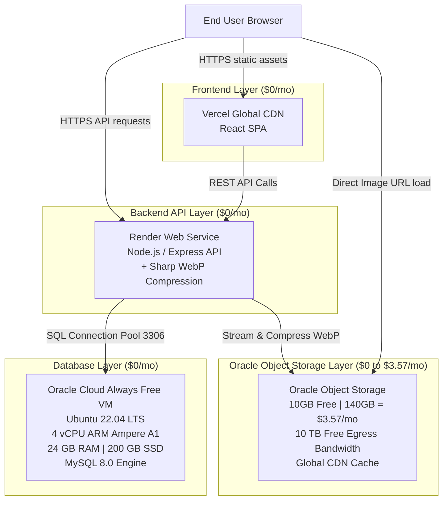

# End-to-End Cloud Migration Blueprint & 5-Provider Cost Sheet
**Application**: Adilabad App (React SPA + Express Node API + 100GB MySQL DB + Heavy Media Layer)  
**Target Budget**: **$0 to Ultra-Low Cost ($0 - $3.57/mo)**

---

## Executive Summary & System Architecture

This guide provides an end-to-end technical roadmap to host the Adilabad application in the cloud for **$0 to $3.57/month**, supporting up to a **120 GB MySQL Database**, 150 GB of heavy media, 600 GB outbound bandwidth, and 25,000 monthly active users.

---

## Realistic Startup Usecase Scenario & 5-Provider Cost Sheet

| Line Item / Resource | **Arch A: Oracle Storage + Hybrid (Recommended)** | **Arch B: Cloudflare R2 + Hybrid** | **Arch C: Microsoft Azure** | **Arch D: Amazon Web Services (AWS)** | **Arch E: Google Cloud (GCP)** |
| :--- | :--- | :--- | :--- | :--- | :--- |
| **Frontend SPA Hosting** | **$0.00** (Vercel Free) | **$0.00** (Vercel Free) | **$0.00** (Static Web Apps Free) | **$5.00** (CloudFront/S3) | **$2.00** (Firebase Hosting) |
| **Backend API Compute** | **$0.00** (Render Free) | **$0.00** (Render Free) | **$13.00** (App Service B1) | **$15.00** (EC2 t3.small) | **$8.00** (Cloud Run) |
| **MySQL Database (120GB)** | **$0.00** (Oracle Always Free 24GB RAM VM) | **$0.00** (Oracle Always Free 24GB RAM VM) | **$32.80** (Azure MySQL Flex B1ms) | **$38.00** (RDS MySQL 120GB) | **$45.00** (Cloud SQL 120GB) |
| **Media Storage (150GB)** | **$3.57** (10GB Free + 140GB @ $0.0255/GB) | **$2.10** (10GB Free + 140GB @ $0.015/GB) | **$3.20** (Azure Blob Hot 150GB) | **$3.45** (S3 Standard 150GB) | **$3.00** (GCS Standard 150GB) |
| **Media Egress (600GB)** | **$0.00** (Included in Oracle 10 TB Free Egress!) | **$0.00** (Included in R2 $0 Egress) | **$43.50** (500GB @ $0.087/GB Egress) | **$51.00** ($0.085/GB CloudFront) | **$66.00** ($0.11/GB Egress) |
| **API Requests (3M/mo)** | **$0.00** | **$0.00** | **$0.00** | **$3.00** | **$2.40** |
| **TOTAL MONTHLY COST** | 🏆 **$3.57 / month** | 🥈 **$2.10 / month** | 🥉 **$92.50 / month** | ❌ **$115.45 / month** | ❌ **$126.40 / month** |
