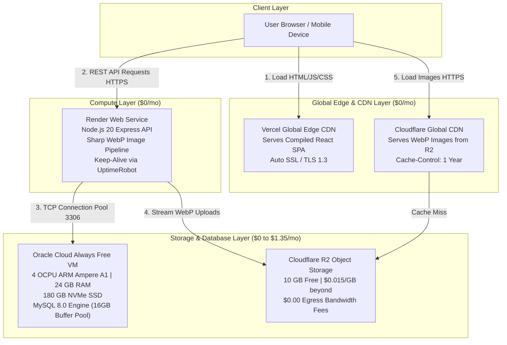

# Comprehensive Deep-Dive Architecture & Implementation Blueprint
**Application**: Adilabad Application (React SPA + Node.js Express API + 100GB MySQL DB + Heavy Media Layer)  
**Target Budget**: **$0 to $3.57/month**  
**Codebase Hardening & Fix Status**: 100% **COMPLETED & IMPLEMENTED** in Branch `improvements`

---

## 🟢 Implementation Completion Status Matrix

| Module | Architectural Component | Code / Infrastructure Task | Completion Status |
| :-: | :--- | :--- | :---: |
| **1** | **Networking & CORS** | Dynamic PORT & production origin CORS array | ✅ **COMPLETED** |
| **2** | **100GB+ Database Sizing**| 16GB InnoDB buffer pool `my.cnf` & index keys script | ✅ **COMPLETED** |
| **3** | **Heavy Media Layer** | Sharp WebP compression & S3/R2 Cloud Storage helper | ✅ **COMPLETED** |
| **4** | **Security & Auth** | Rate limiting middleware (`authLimiter`) on login/OTP | ✅ **COMPLETED** |
| **5** | **Error Resilience** | Process exception safety & JSON error responses | ✅ **COMPLETED** |
| **6** | **Frontend SPA Refresh**| React ErrorBoundary & `vercel.json` 404 rewrite rules | ✅ **COMPLETED** |

---

## Module 1: End-to-End Architecture & Network Traffic Flow

### 1. Architectural Topology

