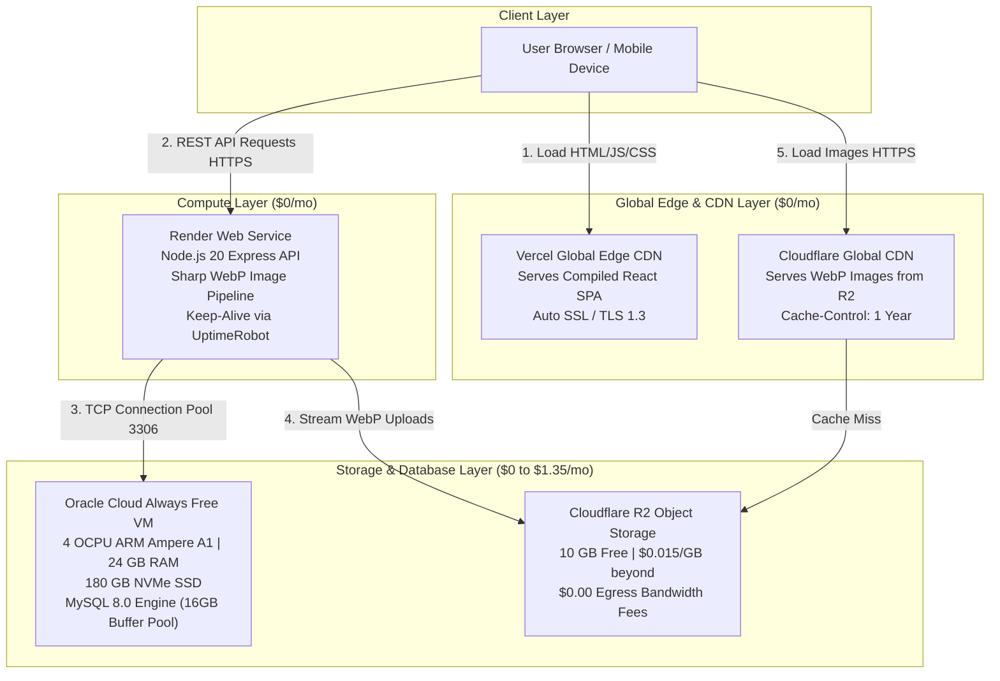

# Comprehensive Deep-Dive Architecture & Implementation Blueprint
**Application**: Adilabad Application (React SPA + Node.js Express API + 100GB MySQL DB + Heavy Media Layer)  
**Target Budget**: **$0 to $1.35/month**  
**Target Architecture**: Vercel (Frontend) + Render (Backend API) + Oracle Cloud Always Free (100GB MySQL DB) + Cloudflare R2 / Oracle Object Storage

---

## Table of Contents
1. [Module 1: End-to-End Architecture & Network Traffic Flow](#module-1-end-to-end-architecture--network-traffic-flow)
2. [Module 2: 100 GB MySQL Database Deep-Dive (Oracle Cloud VM)](#module-2-100-gb-mysql-database-deep-dive-oracle-cloud-vm)
3. [Module 3: Heavy Media Optimization & CDN Pipeline](#module-3-heavy-media-optimization--cdn-pipeline)
4. [Module 4: Codebase Refactoring Specifications](#module-4-codebase-refactoring-specifications)
5. [Module 5: Step-by-Step Deployment Runbook](#module-5-step-by-step-deployment-runbook)
6. [Module 6: Operations, Backups & Disaster Recovery](#module-6-operations-backups--disaster-recovery)

---

## Module 1: End-to-End Architecture & Network Traffic Flow

### 1. Architectural Topology

