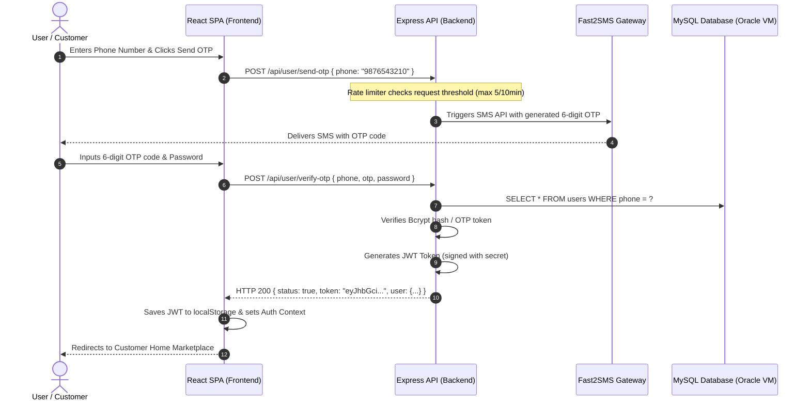
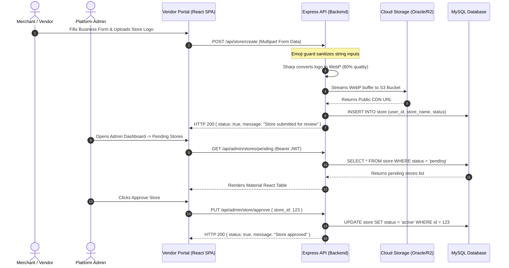
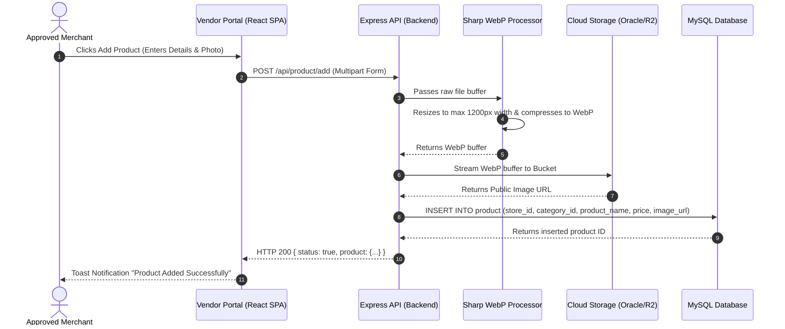
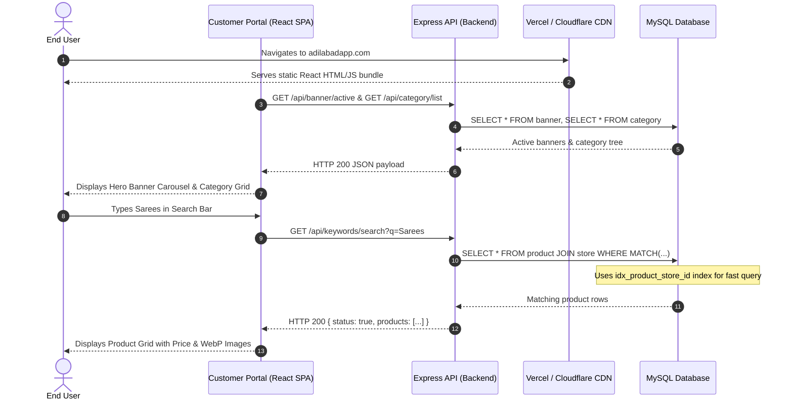

# End-to-End System & User Functional Flow Documentation
**Application**: Adilabad Application (React SPA + Node.js Express API + MySQL 8.0)

This document details the functional user journeys, network communications, data lifecycle, and backend-frontend interaction sequences across both services.

---

## 1. User Registration & Authentication Flow

---

## 2. Merchant Store Onboarding & Admin Approval Flow

---

## 3. Product Catalog Upload & Sharp Optimization Flow

---

## 4. Customer Marketplace Search & Catalog Browsing Flow

---

## 5. Summary Matrix of Core Data Workflows

| Functional Journey | Initiated By | Key API Endpoint | Primary Data Store | Output Artifact |
| :--- | :--- | :--- | :--- | :--- |
| **Account Creation** | Customer / Merchant | `POST /api/user/verify-otp` | MySQL `users` table | JWT Token stored in localStorage |
| **Store Setup** | Merchant | `POST /api/store/create` | MySQL `store` + Object Storage | Store profile marked `pending` |
| **Admin Moderation**| Admin | `PUT /api/admin/store/approve` | MySQL `store` table | Store status updated to `active` |
| **Product Publishing**| Merchant | `POST /api/product/add` | MySQL `product` + Object Storage | WebP Image URL + Indexed catalog row |
| **Ad Banner Campaign**| Admin / Merchant | `POST /api/banner/create` | MySQL `banner` + Object Storage | Displayed on Customer Homepage Carousel |
| **Marketplace Search**| Customer | `GET /api/keywords/search` | MySQL `product` & `store` indexes | Filtered product & store cards |
