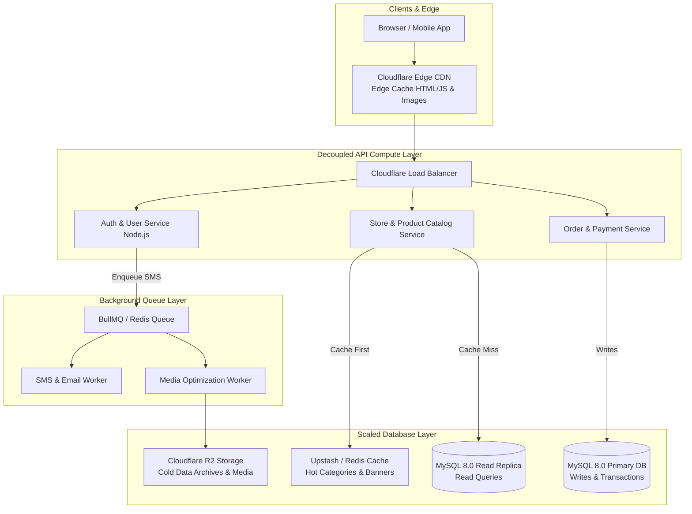

# Enterprise Scaling Roadmap (Growth to 100K+ Users & 500GB+ DB)
**Application**: Adilabad Application (`AdilabadBackEnd` & `AdilabadFrontEnd`)

This document outlines the technical architecture considerations, caching strategies, database sharding, and microservices decomposition required to scale the Adilabad application beyond initial startup tier (25K MAU) up to **100,000+ Monthly Active Users** and **500 GB+ Database Datasets**.

---

## 🚀 Scaling Architecture Overview

---

## 1. Key Scaling Milestones

1. **Redis Caching Layer (Eliminate 80% DB Read Queries)**: Cache hot categories, banners, and search keywords in Upstash Redis.
2. **Background Job Queues (BullMQ + Redis)**: Offload SMS OTP sending, email notifications, and heavy image optimization tasks out-of-band to background workers.
3. **MySQL Primary-Replica Read/Write Splitting**: Route `SELECT` queries to Read Replicas and `INSERT/UPDATE` queries to Primary DB.
4. **Table Range Partitioning**: Partition `orders` table by year/month (`PARTITION BY RANGE (YEAR(created_at))`).
5. **Observability & APM**: Integrate Sentry for uncaught exception monitoring and k6 for load testing simulating 1,000 concurrent users.
